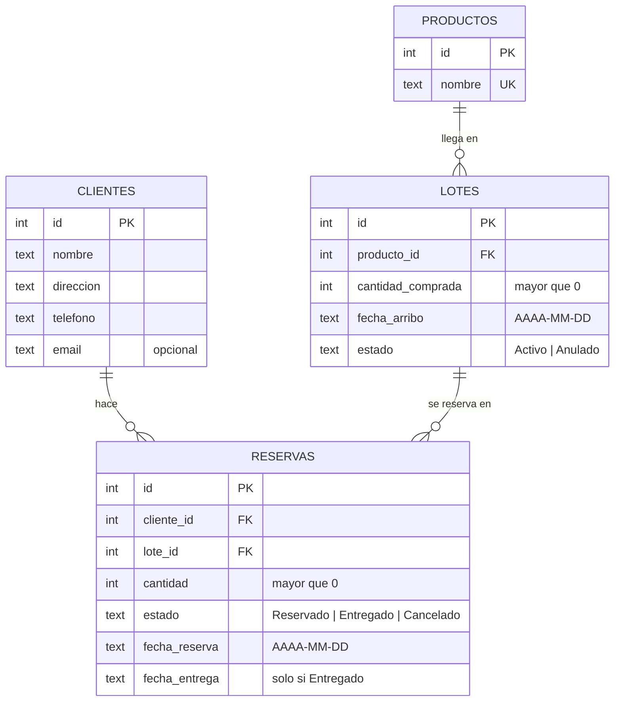

# Modelo de datos — Sistema de Reservas

> Resultado de la **clase 2**. Pasamos de los requisitos y bocetos de la clase 1
> a las **tablas** que va a tener la base. Todavía no escribimos Python.

## 1. De los sustantivos a las entidades

Si subrayamos los sustantivos del [glosario](requisitos.md#3-glosario) aparecen
los candidatos a tabla: **Cliente**, **Producto**, **Lote**, **Reserva**.

"Disponible" y "Reservado" también son sustantivos… pero **no son cosas**: son
**cuentas** que se hacen sobre los lotes y las reservas. Eso los deja afuera
como columnas (ver sección 4).

## 2. Diagrama



Cómo se lee: un **cliente** hace muchas reservas; un **producto** llega en muchos
lotes; un **lote** se reserva en muchas reservas. Cada reserva pertenece a
**un** cliente y **un** lote.

## 3. Relaciones

| Desde | Hacia | Cardinalidad | Al borrar el padre |
|-------|-------|--------------|--------------------|
| `lotes.producto_id` | `productos.id` | 1 producto → N lotes | `RESTRICT` |
| `reservas.cliente_id` | `clientes.id` | 1 cliente → N reservas | `RESTRICT` |
| `reservas.lote_id` | `lotes.id` | 1 lote → N reservas | `RESTRICT` |

`RESTRICT` = la base **se niega** a borrar un cliente, producto o lote que tenga
hijos. Es coherente con **RN-08** ("nada se borra"): las bajas son cambios de
estado, no `DELETE`.

## 4. Decisiones de diseño (y los errores que corregimos)

El sistema real en el que se basa el curso funciona, pero su base tiene
problemas que vale la pena ver. Cada uno es una decisión que acá tomamos distinto.

### 4.1 La reserva guarda el lote, y nada más

Pregunta que quedó abierta en los [bocetos](bocetos.md#reservas-rf-08-a-rf-11):
¿la reserva tiene que guardar el **producto** y la **fecha de arribo**?

**No.** Los dos se obtienen del lote:

```
reserva ──lote_id──▶ lote ──producto_id──▶ producto
                      └── fecha_arribo
```

La versión original los guardaba *también* en la reserva. Problema: cuando un
envío se atrasa (RF-06) hay que cambiar la fecha en el lote **y** en todas sus
reservas. Si alguna se olvida, la base queda diciendo dos cosas distintas.

> **Regla:** cada dato vive en **un solo lugar**. Si se puede llegar a él
> siguiendo una clave foránea, no se copia. (Esto es lo que en la teoría se
> llama *normalizar*.)

Por lo mismo, el lote **no** guarda el nombre del producto.

### 4.2 Disponible y reservado se calculan, no se guardan

La versión original tenía columnas `cantidad_disponible`, `cantidad_reservada`,
`stock_disponible`… y **cada operación** tenía que acordarse de actualizarlas a
mano. Un solo olvido y los números dejan de cerrar.

Acá son **cuentas** que la base hace cuando se le pregunta:

```
reservado  = suma de reservas del lote en estado "Reservado"
entregado  = suma de reservas del lote en estado "Entregado"
disponible = comprada − reservado − entregado      (0 si el lote está Anulado)
```

Para no repetir la cuenta en cada consulta la guardamos como **vista**
(`v_lotes` y `v_productos` en [`esquema.sql`](../datos/esquema.sql)). Una vista
se consulta igual que una tabla, pero siempre está al día porque no guarda nada.

¿Y el rendimiento? Una importadora maneja cientos o pocos miles de reservas:
SQLite hace esas sumas en milisegundos. Guardar el resultado sería optimizar un
problema que no tenemos.

### 4.3 Fechas en formato ISO (`AAAA-MM-DD`)

SQLite no tiene tipo "fecha": se guardan como texto. Si se guardan como
`15/11/2026`, ordenar o comparar fechas falla (`"02/12/2026" < "15/11/2026"`).
En formato ISO (`2026-11-15`) el orden alfabético **es** el orden cronológico.

La pantalla muestra `15/11/2026`; la base guarda `2026-11-15`. Convertir es
trabajo de la interfaz (clase 5).

### 4.4 Estados en lugar de borrar

Reservas y lotes tienen una columna `estado` en vez de borrarse (RN-08). Así
queda la historia: quién reservó qué, qué se entregó, qué lote se cayó.

### 4.5 Nombres simples y consistentes

Cada tabla tiene su clave `id`; las claves foráneas se llaman `<tabla>_id`
(`cliente_id`, `lote_id`). La versión original usaba `nro_cliente`,
`nombre_cliente`, `direccion_cliente`… repetir el nombre de la tabla en cada
columna no aporta: `clientes.nombre` ya dice de quién es el nombre.

## 5. Qué controla la base y qué controla el programa

| Regla | ¿Quién la controla? | Cómo |
|-------|---------------------|------|
| RN-02 cantidad > 0 | **Base** | `CHECK (cantidad > 0)` |
| Estados válidos | **Base** | `CHECK (estado IN (...))` |
| Fecha con formato válido | **Base** | `CHECK (date(fecha) IS fecha)` ¹ |
| Entregada ⇔ tiene fecha de entrega | **Base** | `CHECK` combinado |
| No reservar para un cliente/lote inexistente | **Base** | `FOREIGN KEY` |
| RN-08 nada se borra | **Base** | `ON DELETE RESTRICT` |
| RN-01 no reservar más de lo disponible | **Programa** (clase 4) | mira *otras filas* |
| RN-03 entregar desde la fecha de arribo | **Programa** (clase 4) | mira *otra tabla* |
| RN-04, RN-06 transiciones de estado | **Programa** (clase 4) | depende del estado anterior |
| RN-05 cancelar devuelve unidades | **Automático** | la vista ya no cuenta las canceladas |
| RN-07 anular lote cancela sus reservas | **Programa** (clase 4) | varias filas en una transacción |

¹ ¿Por qué `IS` y no `=`? Con `'15/11/2026'`, `date(...)` devuelve `NULL`, y
`NULL = algo` da `NULL`… que un `CHECK` **deja pasar**. `IS` compara sin esa
trampa: `NULL IS '15/11/2026'` es falso y la fecha se rechaza. (Y en
`fecha_entrega`, que puede estar vacía, `NULL IS NULL` es verdadero.)

Un `CHECK` solo puede mirar **la fila que se está guardando**. Las reglas que
necesitan consultar otras filas van en `negocio.py`.

> Fijate en RN-05: con los números guardados a mano, "cancelar devuelve las
> unidades" era código que había que escribir (y que podía fallar). Con la vista
> no hay nada que programar: la reserva cancelada simplemente deja de sumar.

## 6. Qué quedó afuera

Tablas del sistema real que **no** llevamos al curso (ver
[fuera de alcance](requisitos.md#7-fuera-de-alcance-lo-que-no-hacemos-en-este-curso)):

- `terminales` — varias PCs usando la misma base.
- `info_empresa` — datos de la empresa y **configuración de correo, con la
  contraseña del mail guardada en texto plano dentro de la base**. Otro error
  de diseño para comentar: las credenciales no van en la base de datos ni en el
  repositorio.
